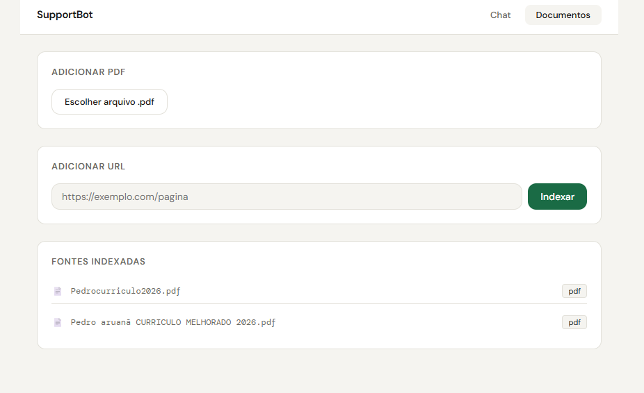

# SupportBot — RAG Chatbot Empresarial

Chatbot de suporte com RAG (Retrieval-Augmented Generation) que responde perguntas com base em documentos PDF e páginas web da empresa.

Desenvolvido por **Pedro Aruanã**

**Stack:** Python · FastAPI · LangChain · Google Gemini · ChromaDB · React · Vite

---

## Funcionalidades

- Upload de PDFs e indexação automática de páginas web
- Busca semântica por similaridade vetorial (ChromaDB)
- Respostas geradas pelo Gemini 2.5 Flash com base nos documentos
- Histórico de conversa por sessão (últimos 5 turnos)
- Citação das fontes usadas em cada resposta
- Interface React com abas de Chat e Gestão de Documentos

---

## Pré-requisitos

- Python 3.11+
- Node.js 20+
- Chave da API Gemini (gratuita): https://aistudio.google.com/app/apikey

---

## Screenshots

### Chat


### Documentos


---

## Como rodar

### 1. Clone e configure

```bash
git clone https://github.com/Pedroaruana/supportbot.git
cd supportbot

# Configure a chave da API
cp backend/.env.example backend/.env
# Edite backend/.env e adicione sua GEMINI_API_KEY
```

### 2. Backend

```bash
cd backend
python -m venv venv
source venv/bin/activate       # Windows: venv\Scripts\activate
pip install -r requirements.txt
uvicorn app.main:app --reload
```

API disponível em: http://localhost:8000
Documentação Swagger: http://localhost:8000/docs

### 3. Frontend

```bash
cd frontend
npm install
npm run dev
```

Interface disponível em: http://localhost:5173

### 4. Com Docker (opcional)

```bash
cp backend/.env.example backend/.env
# Edite backend/.env com sua chave
docker compose up --build
```

---

## Como usar

1. Acesse http://localhost:5173
2. Vá na aba **Documentos**
3. Faça upload de um PDF ou cole uma URL
4. Volte ao **Chat** e faça perguntas sobre o conteúdo

---

## Rodando novamente após clonar

O `venv/`, `.env` e `chroma_db/` não vão para o GitHub. Então toda vez que clonar o projeto em uma máquina nova, siga esses passos:

### 1. Recriar o ambiente virtual

```bash
cd backend
python -m venv venv
venv\Scripts\activate
pip install -r requirements.txt
```

### 2. Recriar o .env com sua chave

```bash
cp backend/.env.example backend/.env
# Edite backend/.env e adicione sua GEMINI_API_KEY
```

### 3. Reindexar os documentos

Os documentos indexados não são salvos no GitHub. Após clonar o projeto, acesse a aba **Documentos** e faça upload dos PDFs novamente.

