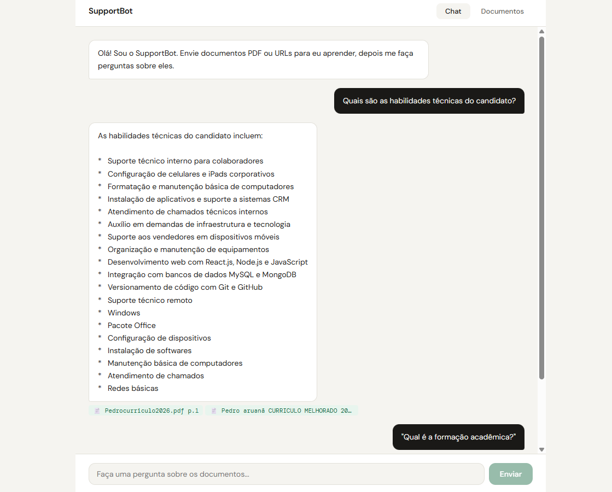
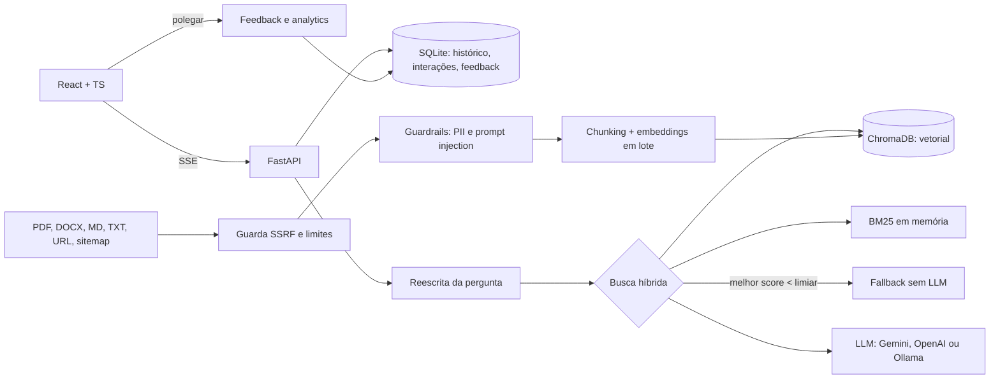

# SupportBot — RAG Chatbot Empresarial


Chatbot de suporte que responde perguntas com base em PDFs, DOCX, Markdown, TXT, páginas web e sitemaps da empresa, citando os trechos usados.

Desenvolvido por **Pedro Aruanã**

**Stack:** Python, FastAPI, LangChain, Google Gemini, ChromaDB, BM25, SQLite, React, TypeScript, Vite




---

## O que tem de diferente

- **Busca híbrida:** vetorial (cosseno) e BM25 fundidas por Reciprocal Rank Fusion. O vetorial pega o sentido, o BM25 pega termos exatos (nomes de plano, códigos, valores).
- **Reescrita da pergunta:** follow-ups como "e no plano Pro?" viram uma pergunta autossuficiente antes da busca.
- **Citações verificáveis:** a resposta cita `[1]`, `[2]`, e cada citação abre o trecho original com a similaridade.
- **Fallback sem custo:** se o melhor trecho fica abaixo de `MIN_RELEVANCE`, o LLM nem é chamado e o bot admite que não sabe.
- **Streaming (SSE):** resposta token a token no frontend.
- **Ingestão idempotente:** hash do conteúdo evita duplicatas e reenviar um arquivo alterado substitui os chunks antigos. Fontes podem ser removidas.
- **Avaliação reproduzível:** dataset com perguntas respondíveis e fora de escopo, comparando busca vetorial pura contra híbrida.
- **LLM trocável por configuração:** `LLM_PROVIDER` aceita Gemini, OpenAI ou Ollama local, sem mexer no código do pipeline.
- **Vários formatos:** PDF, DOCX (parágrafos e tabelas), Markdown, TXT, páginas web e sitemaps (inclusive índice de sitemaps).
- **Guardrails na ingestão:** CPF (validado pelos dígitos) e e-mail são mascarados antes de indexar, e frases com prompt injection são removidas do documento. Cada modo é configurável.
- **Feedback e analytics:** polegar por resposta, painel com a taxa de perguntas sem resposta, lista agrupada do que os documentos não cobrem e as respostas mal avaliadas.
- **Segurança e operação:** proteção SSRF, limites de upload, API key, rate limit, logs JSON, `/metrics`, testes e CI.

## Arquitetura



## Decisões e trade-offs

| Decisão | Motivo | Limite conhecido |
|---|---|---|
| Pipeline próprio em vez de `ConversationalRetrievalChain` | Controle do fluxo (fallback, streaming, citações) e menos código legado | Menos abstração pronta |
| RRF em vez de somar scores | Scores de BM25 e cosseno não são comparáveis; RRF usa só a posição | Não usa a magnitude dos scores |
| Corte por similaridade antes do LLM | Evita alucinação e gasto de tokens | O limiar depende do modelo de embedding, ajuste com o eval |
| Índice BM25 em memória, reconstruído após ingestão | Simples e rápido para milhares de chunks | Para volumes grandes, usar um índice dedicado |
| Histórico em SQLite | Sobrevive a restart, sem infraestrutura extra | Para várias instâncias, trocar por Redis ou Postgres |
| Métricas em memória | Zero dependência | Para várias instâncias, exportar para Prometheus |
| SSRF validado por DNS a cada redirect | Bloqueia loopback, rede privada e metadados de nuvem | Janela de DNS rebinding, em produção usar proxy de egress |
| Prompt injection: remover a frase, não o trecho | Em documentos curtos o documento inteiro é um trecho só, e descartá-lo apagaria conteúdo legítimo (erro que o teste real mostrou) | Detecção por padrões, não pega ataques novos ou ofuscados |
| CPF mascarado só se os dígitos verificadores batem | Evita mascarar protocolos e números aleatórios | Não cobre CNPJ, RG ou cartão por padrão |
| PII também mascarada em log, histórico e analytics | O painel não vira um depósito de dados pessoais | O chat em si ainda envia a pergunta original ao LLM |
| Embeddings ficam no Gemini mesmo trocando o LLM | Trocar o modelo de embedding exige reindexar tudo | Quem usa só Ollama ainda precisa da chave do Gemini |
| Sitemap indexa só o mesmo domínio e em sequência | Evita virar um crawler aberto e respeita o rate limit | Sites grandes demoram, o limite padrão é 20 páginas |

## Como rodar

Pré-requisitos: Python 3.11+, Node 20+ e uma chave do Gemini (https://aistudio.google.com/app/apikey).

```bash
git clone https://github.com/Pedroaruana/SuportBot.git
cd SuportBot
cp backend/.env.example backend/.env   # preencha GEMINI_API_KEY
```

Backend:

```bash
cd backend
python -m venv venv
source venv/bin/activate        # Windows: venv\Scripts\activate
pip install -r requirements.txt
uvicorn app.main:app --reload
```

Swagger em http://localhost:8000/docs

Frontend:

```bash
cd frontend
npm install
npm run dev
```

Interface em http://localhost:5173

Docker:

```bash
docker compose up --build
```

O índice vetorial e o histórico ficam no volume `app_data`.

Atenção ao atualizar de uma versão anterior: o índice agora usa distância cosseno (coleção `supportbot_docs_v2`), então é preciso reenviar os documentos.

## Configuração

Todas as variáveis estão em `backend/.env.example`. As principais:

| Variável | Padrão | Função |
|---|---|---|
| `API_KEY` | vazio | Exige o header `X-API-Key`. Vazio desliga a autenticação |
| `ALLOWED_ORIGINS` | `http://localhost:5173` | Origens do CORS |
| `MIN_RELEVANCE` | `0.70` | Similaridade mínima para tentar responder |
| `RETRIEVER_K` / `FETCH_K` | `4` / `20` | Trechos enviados ao LLM / candidatos por busca |
| `MAX_UPLOAD_MB` | `10` | Tamanho máximo de arquivo |
| `RATE_LIMIT_CHAT_PER_MIN` | `20` | Requisições de chat por minuto por IP |
| `LLM_PROVIDER` | `gemini` | `gemini`, `openai` ou `ollama` |
| `LLM_MODEL` | vazio | Modelo do provedor. Vazio usa `gemini-2.5-flash-lite`, `gpt-4o-mini` ou `llama3.1` |
| `PII_MODE` / `PII_TYPES` | `mask` / `cpf,email` | `off`, `mask` ou `block`. Tipos: `cpf`, `email`, `phone` |
| `PII_ALLOW_EMAILS` | vazio | E-mails ou domínios que não são mascarados (ex.: `suporte@empresa.com,@empresa.com`) |
| `INJECTION_MODE` | `drop` | `off`, `flag` (só avisa), `drop` (remove as frases) ou `block` (recusa o documento) |
| `MAX_SITEMAP_URLS` | `20` | Máximo de páginas por sitemap |

Para usar OpenAI ou Ollama, instale os pacotes opcionais e defina o provedor. Esses dois caminhos foram testados só com simulação nos testes, não contra os serviços reais.

```bash
pip install -r requirements-optional.txt
# .env: LLM_PROVIDER=ollama e LLM_MODEL=llama3.1   (ou openai + OPENAI_API_KEY)
```

No frontend, `VITE_API_URL` e `VITE_API_KEY` ficam no bundle. Use `VITE_API_KEY` só em demo, em produção coloque um proxy no servidor.

## API

| Método | Rota | Descrição |
|---|---|---|
| POST | `/api/chat/stream` | Resposta em streaming (SSE): eventos `sources`, `token`, `done` |
| POST | `/api/chat/` | Resposta completa em JSON |
| DELETE | `/api/chat/{session_id}` | Limpa o histórico da sessão |
| POST | `/api/ingest/file` | Indexa PDF, DOCX, MD ou TXT (`/api/ingest/pdf` continua como alias) |
| POST | `/api/ingest/url` | Indexa uma página web |
| POST | `/api/ingest/sitemap` | Indexa as páginas de um sitemap (mesmo domínio, até `limit`) |
| POST | `/api/feedback` | Avalia uma resposta (`message_id`, `rating`: `up` ou `down`, `comment` opcional) |
| GET | `/api/analytics/summary` | Perguntas, taxa de fallback, votos e satisfação |
| GET | `/api/analytics/unanswered` | Perguntas em fallback, agrupadas e ordenadas por frequência |
| GET | `/api/analytics/downvoted` | Respostas avaliadas negativamente |
| GET | `/api/ingest/sources` | Lista as fontes com contagem de chunks |
| DELETE | `/api/ingest/sources?source=` | Remove uma fonte |
| GET | `/health`, `/metrics` | Saúde e métricas (latência p50/p95, tokens estimados, fallbacks) |

## Testes e avaliação

Testes (não usam rede nem a API do Gemini, os embeddings e o LLM são simulados):

```bash
cd backend
pip install -r requirements-dev.txt
pytest
ruff check .
```

Avaliação do RAG com o Gemini de verdade, usando um corpus sintético em `backend/eval/`:

```bash
cd backend
python -m eval.run_eval              # retrieval e respostas
python -m eval.run_eval --no-answers # só retrieval, sem gastar tokens do LLM
```

O script gera `backend/eval/results.md` com hit@1, hit@k e MRR (vetorial contra híbrida), palavras esperadas na resposta, presença de citação e recusa em perguntas fora de escopo. Rode antes de ajustar `MIN_RELEVANCE` ou o tamanho dos chunks.

Resultado atual (Gemini `gemini-2.5-flash-lite` e `gemini-embedding-001`, corpus de 3 PDFs, 13 perguntas, chunks de 300 caracteres, k=4):

| Busca | hit@1 | hit@4 | MRR |
|---|---|---|---|
| Vetorial | 0.80 | 1.00 | 0.90 |
| Híbrida (vetorial + BM25) | 1.00 | 1.00 | 1.00 |

| Métrica de resposta | Resultado |
|---|---|
| Palavras esperadas na resposta | 10/10 |
| Resposta com citação `[n]` | 10/10 |
| Recusa em perguntas fora do escopo | 3/3 |

O ganho da busca híbrida está na primeira posição (hit@1). O corpus é pequeno e sintético, então os números mostram a direção e não uma garantia em documentos reais. O `MIN_RELEVANCE=0.70` foi escolhido olhando as similaridades dessas 13 perguntas: as válidas ficaram entre 0.72 e 0.81, as totalmente alheias abaixo de 0.65. A pergunta fora de escopo que cita o nome da empresa passa do corte e é recusada pelo próprio modelo.

## Estrutura

```
backend/
  app/
    api/        rotas (chat, ingest)
    core/       config, segurança (SSRF, API key, rate limit), logs e métricas
    services/   ingestão, busca híbrida, RAG, histórico
  eval/         corpus, dataset e script de avaliação
  tests/
frontend/src/   App, api.ts (streaming SSE), componentes
```

## Licença

MIT, veja o arquivo [LICENSE](LICENSE).
